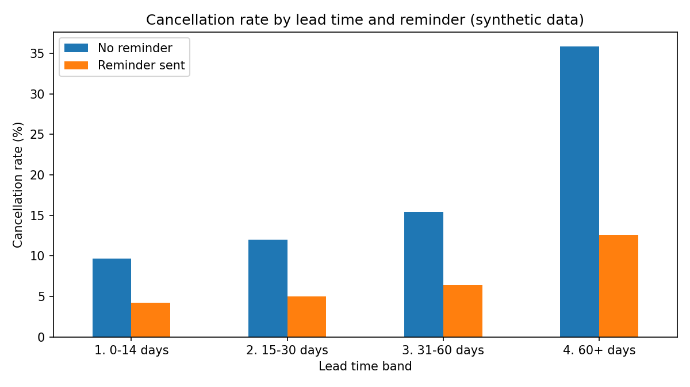
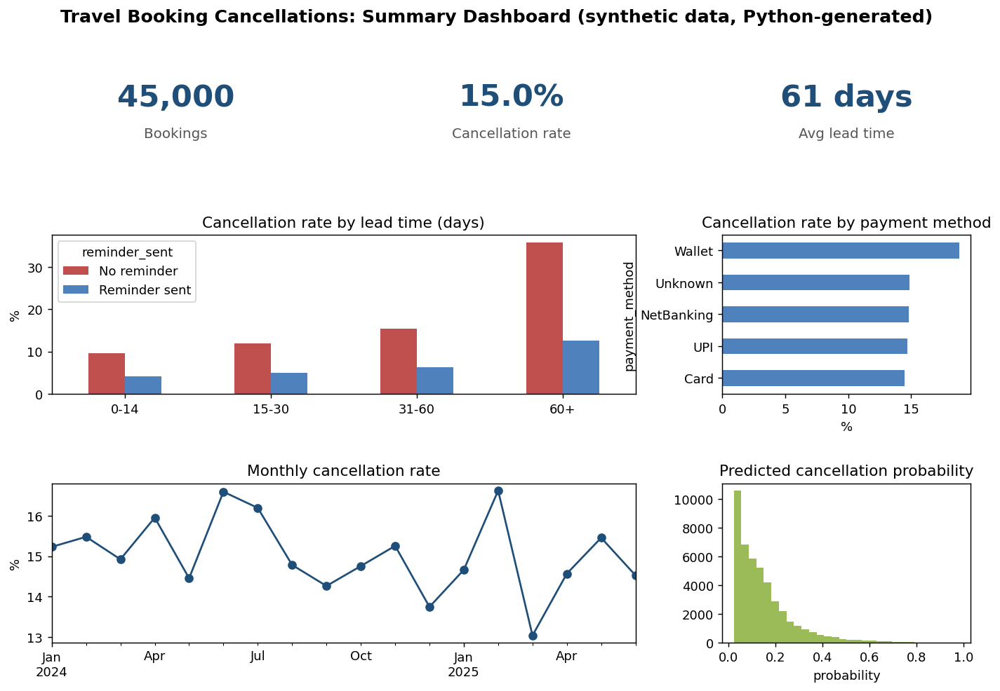

# Travel Booking Cancellation Analysis

An end-to-end analytics project that investigates why travel bookings get cancelled, and which customer or booking patterns carry the most risk. It cleans raw booking data, segments bookings by lead time with SQL window functions, and models cancellation probability in Python. The outputs feed a Power BI dashboard.

> **Data notice:** This repository uses a **synthetic dataset** created by `generate_data.py`. It contains no real client or customer data, and the numbers it produces are illustrative. They are not results from any client engagement.

## Business problem

A travel business sees a spike in booking drop-offs and cancellations but cannot say why. The goal is to find where cancellation risk is concentrated and which low-cost action (such as an automated reminder) could reduce it.

## Approach

1. **Requirements:** turn "we are losing bookings" into testable questions (which segments cancel most, and does a reminder change the outcome).
2. **Clean:** remove duplicate bookings, fill missing ages with the median, label missing payment methods as `Unknown`, and drop invalid lead times.
3. **Segment:** use SQL (`CASE` bands, `COUNT`/`SUM ... OVER (PARTITION BY ...)`) to compare cancellation rates by lead-time band and reminder status.
4. **Model:** logistic regression estimates each booking's cancellation probability from lead time, reminder status, age and payment method.
5. **Report:** CSV outputs are ready to load into Power BI (see below).

## Project structure

```
.
├── generate_data.py        # builds the synthetic dataset (45,000 rows + messy records)
├── analysis.py             # clean, SQL segmentation, model, chart
├── make_dashboard.py       # static summary dashboard image
├── sql/lead_time_segments.sql
├── requirements.txt
├── images/                 # chart used in this README
├── data/                   # generated CSV and SQLite files (git-ignored)
└── output/                 # generated results (git-ignored)
```

## How to run

```bash
python -m venv .venv && source .venv/bin/activate   # Windows: .venv\Scripts\activate
pip install -r requirements.txt
python generate_data.py
python analysis.py
python make_dashboard.py   # optional: summary image
```

## Example output (synthetic data)

For bookings made more than 60 days ahead, the synthetic data shows roughly 36% cancelling without a reminder versus about 13% with one. The logistic regression reaches a ROC-AUC of about 0.74. Your numbers will match these because the random seed is fixed.



## Summary dashboard image

`make_dashboard.py` creates a static summary image with matplotlib. It is a Python visual, **not a Power BI report**.



## Power BI dashboard

Load `output/bookings_scored_for_powerbi.csv` and `output/segments_for_powerbi.csv` into Power BI Desktop. A suggested 3-page layout:

1. **Overview:** total bookings, overall cancellation rate, trend by booking month.
2. **Lead time and reminders:** cancellation rate by lead band, split by reminder status.
3. **Risk:** distribution of predicted cancellation probability by payment method and country.

Example DAX measures:

```
Cancellation Rate = DIVIDE(SUM(bookings[cancelled]), COUNTROWS(bookings))
High Risk Bookings = CALCULATE(COUNTROWS(bookings), bookings[cancel_probability] > 0.3)
```

## Tools

Python (pandas, NumPy, scikit-learn, matplotlib), SQL (SQLite), Power BI.

## License

MIT, see [LICENSE](LICENSE).
